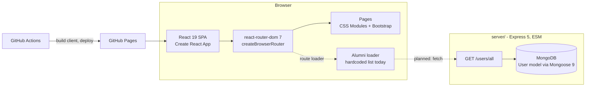

# MCA NITW

Web portal for the MCA department at NIT Warangal -- alumni networking, student
profiles, study materials, placement cell coordination, and academic resources.

[](https://github.com/MCA-NITW/mca_nitw/actions/workflows/ci.yml)
[](https://github.com/MCA-NITW/mca_nitw/actions/workflows/pages.yml)


**Live demo:** [mca-nitw.github.io/mca_nitw](https://mca-nitw.github.io/mca_nitw/)
(frontend only, deployed from `main` by GitHub Actions)

## Overview

A MERN application meant to be the central web portal for MCA students at NIT
Warangal. The goal is to connect current students with alumni, give one place
for study material and placement updates, and keep student and faculty
information in one directory.

## Project status

The frontend shell, routing, theming and page layouts are built. Most data is
still static, and the backend has a single read endpoint. Be clear about this
when you demo it:

- **Routing, navbar, side nav**: Done. Logged-in users get extra routes
  (profile, CR cell, placement cell, alumni, material)
- **Light/dark mode**: Done (toggle adds a `dark` class on `<body>`, CSS
  variables switch)
- **Responsive layout**: Done. On phones the top nav wraps and the side nav
  becomes a bottom tab bar
- **Contact page**: Team cards are live; the form logs to the console, it does
  not send yet
- **Alumni directory**: UI and route loader done; the loader returns a hardcoded
  list, not the API
- **Full profile**: Layout done with placeholder data
- **Login / signup**: UI only. "Login" flips client-side state; there is no auth
  API or password storage yet
- **Home, About, Students, others**: Placeholder headings
- **Backend**: `GET /users/all` reads the `User` collection from MongoDB

## Architecture



- **Client** (`client/`): one router in
  [`client/src/App.js`](client/src/App.js). The route list depends on the
  `isloggedin` state, so protected pages simply do not exist for a logged-out
  visitor and fall through to the error page.
- **Server** (`server/`): [`server/server.js`](server/server.js) connects to
  MongoDB with `CONNECTION_URL` and only starts listening once the connection
  succeeds.
- **Deploy**: [`.github/workflows/pages.yml`](.github/workflows/pages.yml)
  builds the client with `PUBLIC_URL=/mca_nitw`, copies `index.html` to
  `404.html` so deep links work on Pages, and deploys it. The router reads the
  same `PUBLIC_URL` as its `basename`.

## Features

- **Alumni Network** -- Browse alumni cards with a link to the full profile view
- **Student Directory** -- Current student page (placeholder)
- **Study Materials** -- Academic resources page (placeholder)
- **Placement Cell** -- Placement coordination page (placeholder)
- **CR Cell** -- Class Representative page (placeholder)
- **Authentication UI** -- Login and signup forms (no backend yet, see Project status)
- **Light/Dark Mode** -- Theme toggle for comfortable viewing
- **Contact** -- Team cards with LinkedIn, GitHub and Instagram links, plus a
  contact form
- **Responsive Design** -- Works on desktop and mobile devices

## Tech Stack

- **Frontend**: React 19, react-router-dom 7, Create React App 5, CSS Modules,
  Bootstrap 5, react-icons
- **Backend**: Node.js, Express 5 (ESM), Mongoose 9, MongoDB
- **Tooling**: Prettier, GitHub Actions (format check, security scan, client
  build, server syntax check)
- **Deployment**: GitHub Pages (client)

MUI and bcryptjs are installed but not used in the code yet.

## Pages

| Page           | Route            | Description                            |
| -------------- | ---------------- | -------------------------------------- |
| Home           | `/`              | Landing page                           |
| About          | `/about`         | Department information                 |
| Contact        | `/contact`       | Team cards and contact form            |
| Students       | `/students`      | Current student information            |
| Authentication | `/auth?mode=...` | Login and signup forms                 |
| Full Profile   | `/profile`       | Detailed user profile view (logged in) |
| CR Cell        | `/crcell`        | Class representative panel (logged in) |
| Placement Cell | `/placementcell` | Placement activities (logged in)       |
| Alumni         | `/alumni`        | Alumni directory (logged in)           |
| Study Material | `/studymaterial` | Study resources by subject (logged in) |

## Project Structure

```
mca_nitw/
├── client/                      # React frontend (CRA)
│   └── src/
│       ├── App.js              # Router and route lists
│       ├── pages/
│       │   ├── home/           # Landing page
│       │   ├── about/          # Department info
│       │   ├── Alumni/         # Alumni directory + loader
│       │   ├── Authentication/ # Login/Signup
│       │   ├── Students/       # Student listing
│       │   ├── StudyMaterial/  # Resources
│       │   ├── contact/        # Contact cards and form
│       │   ├── PlacementCell/  # Placement info
│       │   ├── CRCell/         # CR coordination
│       │   ├── Fullprofile/    # User profiles
│       │   └── Error/          # Error page
│       ├── components/
│       │   ├── navbar/         # Top navigation
│       │   ├── footer/         # Page footer
│       │   ├── sidenavbar/     # Side navigation (bottom bar on phones)
│       │   └── mode/           # Dark/light toggle
│       └── Layout/             # Auth navigation, fallbacks
├── server/
│   ├── models/
│   │   └── User.js             # User Mongoose schema
│   └── server.js               # Express entry point
├── .github/workflows/          # CI and Pages deploy
├── package.json                # Root orchestration scripts
└── .prettierrc                 # Code formatting
```

## Getting Started

### Prerequisites

- Node.js 24 with its bundled npm (the versions CI uses)
- MongoDB (local or Atlas) for the backend

### Installation

```bash
git clone https://github.com/MCA-NITW/mca_nitw.git
cd mca_nitw

# Install root, client and server dependencies
npm install
npm run set-env
```

The backend reads two variables from `server/.env` (never commit it):

```ini
# local MongoDB or an Atlas connection string
CONNECTION_URL=mongodb://127.0.0.1:27017/mca_nitw
PORT=5000
```

### Running

```bash
# Start both frontend and backend
npm run dev

# Backend only
npm run backend-start

# Frontend only
npm run frontend-start

# Format code
npm run format
```

| Service  | URL                               |
| -------- | --------------------------------- |
| Frontend | `http://localhost:3000`           |
| Backend  | `http://localhost:5000/users/all` |

The backend port comes from `PORT` in `server/.env`.

## Contributing

Contributions from MCA-NITW members and external collaborators are welcome.
Branch from `main`, keep `npm run format` clean, and open a pull request to
`main`. See [CONTRIBUTING.md](CONTRIBUTING.md).

## Organization

This project is maintained by [MCA-NITW](https://github.com/MCA-NITW), the GitHub organization for the MCA department at the National Institute of Technology, Warangal.

## License

This project is licensed under the [GNU General Public License v3.0](LICENSE).
