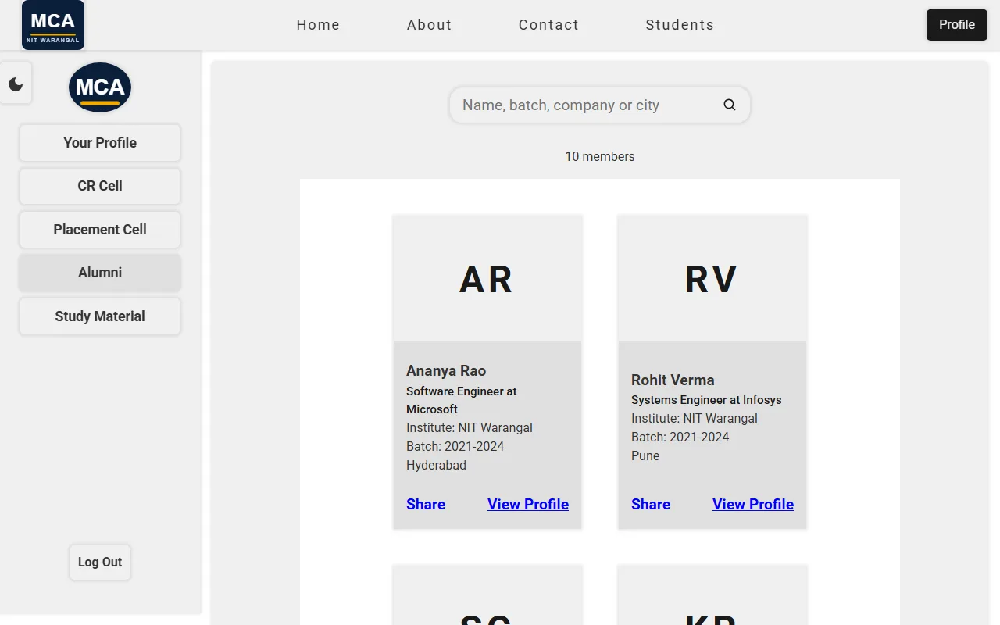
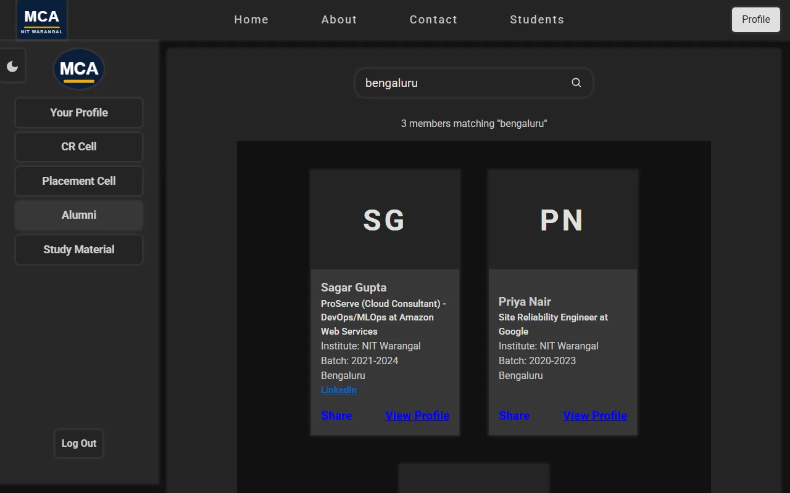
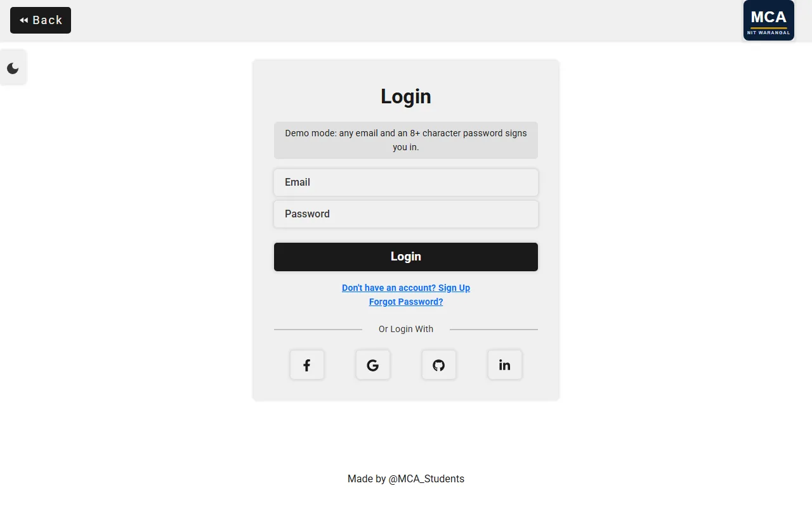
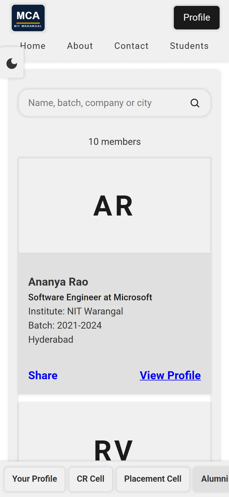
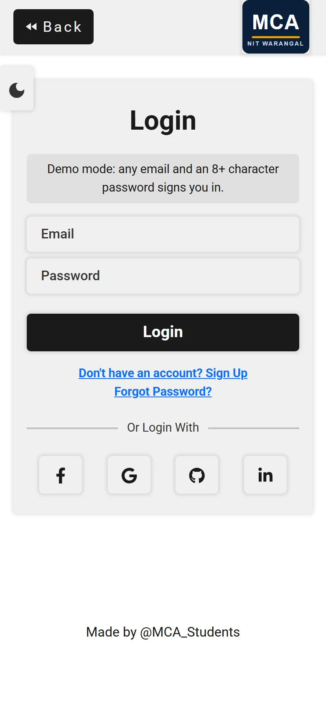
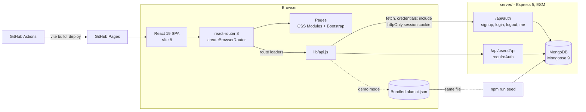

# MCA NITW

Web portal for the MCA department at NIT Warangal -- alumni networking, student
profiles, study materials, placement cell coordination, and academic resources.

[](https://github.com/MCA-NITW/mca_nitw/actions/workflows/ci.yml)
[](https://github.com/MCA-NITW/mca_nitw/actions/workflows/pages.yml)


**Live demo:** [mca-nitw.github.io/mca_nitw](https://mca-nitw.github.io/mca_nitw/)
-- runs in demo mode: sign in with any email and an 8+ character password, then
open Alumni.

[](https://render.com/deploy?repo=https://github.com/MCA-NITW/mca_nitw)

| Alumni directory (desktop)                                           | Dark mode with search                                                    |
| -------------------------------------------------------------------- | ------------------------------------------------------------------------ |
|  |  |

| Sign in (desktop)                                  | Alumni (phone)                                           | Sign in (phone)                                        |
| -------------------------------------------------- | -------------------------------------------------------- | ------------------------------------------------------ |
|  |  |  |

## Overview

A MERN application meant to be the central web portal for MCA students at NIT
Warangal. The goal is to connect current students with alumni, give one place
for study material and placement updates, and keep student and faculty
information in one directory.

## Project status

The alumni directory, sign-up and sign-in work end to end against the Express
API. Most department pages are still placeholders:

- **Accounts**: Done. Sign-up and login hash passwords with bcrypt (12
  rounds) and keep the session in a 7-day JWT inside an httpOnly cookie, so
  page scripts never see the token. `GET /api/auth/me` restores the session on
  reload
- **Alumni directory**: Done. Members only; the route loader calls
  `GET /api/users?q=` and the search box re-queries as you type (300 ms
  debounce, `?q=` stays in the URL)
- **Member routes**: Signed out, `/alumni`, `/profile` and the other member
  pages redirect to login and come back after sign-in
- **Demo mode**: The GitHub Pages build has no API behind it, so it runs on
  the same bundled alumni data the seed script loads. Accounts live in the
  browser tab only
- **Routing, navbar, side nav, light/dark mode**: Done
- **Responsive layout**: Done. On phones the top nav wraps and the side nav
  becomes a bottom tab bar
- **Contact page**: Team cards are live; the form logs to the console, it does
  not send yet
- **Full profile**: Layout done with placeholder data
- **Home, About, Students, others**: Placeholder headings

The seeded alumni (except the maintainer) are fictional sample profiles.

## Architecture



- **Client** (`client/`): the router lives in
  [`client/src/App.jsx`](client/src/App.jsx). It is built once per sign-in or
  sign-out (not on every render) and only after the session check finishes,
  so a signed-in deep link to `/alumni` does not bounce to login. All network
  calls go through [`client/src/lib/api.js`](client/src/lib/api.js), which
  swaps in [`lib/demo.js`](client/src/lib/demo.js) when the build runs with
  `--mode demo`.
- **Server** (`server/`): [`app.js`](server/app.js) builds the Express app and
  [`server.js`](server/server.js) connects to MongoDB before it listens.
  Auth routes are in [`routes/auth.js`](server/routes/auth.js), the directory
  in [`routes/users.js`](server/routes/users.js).
- **Security**: CORS allowlist from `CLIENT_ORIGIN` with credentials, JSON
  bodies capped at 100 kB, login and signup limited to 20 attempts per 15
  minutes per IP, the directory to 60 requests per minute. Login returns the
  same error for an unknown email and a wrong password. Search input is
  regex-escaped before it reaches MongoDB, and the directory never returns
  emails or password hashes.
- **Deploy**: [`.github/workflows/pages.yml`](.github/workflows/pages.yml)
  builds the client with `BASE_PATH=/mca_nitw/`, copies `index.html` to
  `404.html` so deep links work on Pages, and deploys it.
  [`render.yaml`](render.yaml) describes the API for Render.

## Features

- **Alumni Network** -- Search alumni by name, batch, company or city, with a
  link to the full profile view
- **Accounts** -- Sign up, log in and stay signed in across reloads
- **Student Directory** -- Current student page (placeholder)
- **Study Materials** -- Academic resources page (placeholder)
- **Placement Cell** -- Placement coordination page (placeholder)
- **CR Cell** -- Class Representative page (placeholder)
- **Light/Dark Mode** -- Theme toggle for comfortable viewing
- **Contact** -- Team cards with LinkedIn, GitHub and Instagram links, plus a
  contact form
- **Responsive Design** -- Works on desktop and mobile devices

## Tech Stack

- **Frontend**: React 19, react-router 8, Vite 8, CSS Modules, Bootstrap 5,
  react-icons
- **Backend**: Node.js 24, Express 5 (ESM), Mongoose 9, MongoDB, bcryptjs,
  jsonwebtoken, cookie-parser, express-rate-limit
- **Tooling**: Prettier, Playwright (screenshots and the Open Graph card),
  GitHub Actions (format check, security scan, client build, server syntax
  check)
- **Deployment**: GitHub Pages (client), Render blueprint (API)

MUI is installed but not used in the code yet.

### Moving off Create React App

The client moved from Create React App 5 to Vite 8 in 1.6.0. Measured on the
same machine (Node 26.10, npm 11.20) on 2026-10-18, `main` before the move
against this branch:

| Client                                      | CRA 5 (before) | Vite 8 (after) |
| ------------------------------------------- | -------------- | -------------- |
| Installed packages (`npm ls --all`)         | 1,354          | 134            |
| `npm audit` advisories                      | 53             | 0              |
| Production build, warm (`npm run build`)    | 15.2 to 17.6 s | 1.7 to 1.8 s   |
| `--legacy-peer-deps` needed                 | yes            | no             |
| Main JS bundle, gzip (after adds auth code) | 97.48 kB       | 107.92 kB      |

The bundle grew because 1.6.0 also adds the auth flow, the API client and the
bundled demo data.

## Pages

| Page           | Route            | Description                           |
| -------------- | ---------------- | ------------------------------------- |
| Home           | `/`              | Landing page                          |
| About          | `/about`         | Department information                |
| Contact        | `/contact`       | Team cards and contact form           |
| Students       | `/students`      | Current student information           |
| Authentication | `/auth?mode=...` | Login and signup forms                |
| Full Profile   | `/profile`       | Detailed user profile view (members)  |
| CR Cell        | `/crcell`        | Class representative panel (members)  |
| Placement Cell | `/placementcell` | Placement activities (members)        |
| Alumni         | `/alumni?q=`     | Searchable alumni directory (members) |
| Study Material | `/studymaterial` | Study resources by subject (members)  |

## API

| Method | Path               | Auth   | Description                              |
| ------ | ------------------ | ------ | ---------------------------------------- |
| GET    | `/api/health`      | none   | Liveness check (`{ "ok": true }`)        |
| POST   | `/api/auth/signup` | none   | `{ name, email, password, batch? }`, 201 |
| POST   | `/api/auth/login`  | none   | `{ email, password }`, sets the cookie   |
| POST   | `/api/auth/logout` | none   | Clears the cookie, 204                   |
| GET    | `/api/auth/me`     | cookie | Current user, 401 when signed out        |
| GET    | `/api/users?q=`    | cookie | Up to 100 profiles, newest batch first   |

## Project Structure

```
mca_nitw/
├── client/                      # React frontend (Vite)
│   ├── index.html              # Vite entry, meta and Open Graph tags
│   ├── vite.config.js          # base path and /api dev proxy
│   ├── public/                 # logo.svg, favicon.svg, og.png
│   ├── scripts/                # screenshots.js, og-image.js (Playwright)
│   └── src/
│       ├── App.jsx             # Router, session restore, member routes
│       ├── lib/                # api.js (server) and demo.js (demo mode)
│       ├── data/alumni.json    # Demo and seed alumni profiles
│       ├── pages/
│       │   ├── home/           # Landing page
│       │   ├── about/          # Department info
│       │   ├── Alumni/         # Alumni directory, search and loader
│       │   ├── Authentication/ # Login/Signup forms and submit hook
│       │   ├── Students/       # Student listing
│       │   ├── StudyMaterial/  # Resources
│       │   ├── contact/        # Contact cards and form
│       │   ├── PlacementCell/  # Placement info
│       │   ├── CRCell/         # CR coordination
│       │   ├── Fullprofile/    # User profiles
│       │   └── Error/          # Error page
│       ├── components/
│       │   ├── navbar/         # Top navigation
│       │   ├── footer/         # Page footer
│       │   ├── sidenavbar/     # Side navigation (bottom bar on phones)
│       │   └── mode/           # Dark/light toggle
│       └── Layout/             # Auth navigation, fallbacks
├── server/
│   ├── app.js                  # Express app: CORS, JSON, routes, errors
│   ├── auth.js                 # JWT cookie helpers and requireAuth
│   ├── routes/                 # auth.js, users.js
│   ├── models/User.js          # User Mongoose schema
│   ├── seed.js                 # Load alumni.json and a demo account
│   └── server.js               # Connect to MongoDB, then listen
├── docs/screenshots/           # README screenshots (npm run screenshots)
├── render.yaml                 # Render blueprint for the API
├── .github/workflows/          # CI and Pages deploy
├── package.json                # Root orchestration scripts
└── .prettierrc                 # Code formatting
```

## Getting Started

### Prerequisites

- Node.js 24 with its bundled npm (the versions CI uses)
- MongoDB (local or Atlas) for the backend. Without it, run the client in
  demo mode

### Installation

```bash
git clone https://github.com/MCA-NITW/mca_nitw.git
cd mca_nitw

# Install root, client and server dependencies
npm install
npm run set-env
```

The backend reads these variables from `server/.env` (never commit it):

```ini
# local MongoDB or an Atlas connection string
CONNECTION_URL=mongodb://127.0.0.1:27017/mca_nitw
PORT=5000
# any long random string; signs the session cookies
JWT_SECRET=replace-with-a-long-random-string
# optional: comma-separated origins allowed to call the API
CLIENT_ORIGIN=http://localhost:3000
# optional: "none" when the client is on another site (needs HTTPS)
COOKIE_SAMESITE=lax
```

### Running

```bash
# Load 10 sample alumni plus a demo account (demo@example.com / mcanitw-demo)
npm run seed

# Start both frontend and backend
npm run dev

# Backend only (node --watch)
npm run backend-start

# Frontend only
npm run frontend-start

# Frontend without a backend, on the bundled demo data
cd client
npx vite --mode demo

# Format code
npm run format
```

| Service  | URL                                |
| -------- | ---------------------------------- |
| Frontend | `http://localhost:3000`            |
| Backend  | `http://localhost:5000/api/health` |

In development the Vite server proxies `/api` to `http://localhost:5000`, so
the session cookie stays same-origin. Point it elsewhere with `API_PROXY`.

### Screenshots and the Open Graph card

```bash
cd client
npx playwright install chromium   # first run only
npm run screenshots               # docs/screenshots/*.webp from the demo build
npm run og-image                  # public/og.png from public/logo.svg
```

## Deploying the API

1. Create a MongoDB Atlas cluster and copy its connection string.
2. Click **Deploy to Render** above. Render reads [`render.yaml`](render.yaml),
   generates `JWT_SECRET`, and asks for `CONNECTION_URL`.
3. Skip `npm run seed` for a real deployment. It writes the 10 fictional
   alumni and `demo@example.com` with the password printed in this README.
   Only run it against a throwaway database, and set `SEED_DEMO_PASSWORD`
   if that database is reachable by anyone else. Signup is open and does not
   verify email, so "members only" means anyone who registers.
4. In the GitHub repo, add a repository variable `VITE_API_URL` with the
   Render URL (for example `https://mca-nitw-api.onrender.com`) and re-run the
   Pages workflow. With the variable set, the site builds against the API
   instead of demo mode.

The Pages site (`github.io`) and the API (`onrender.com`) are different sites,
so the session cookie is a third-party cookie there. Browsers that block those
(Safari does by default) will not keep the session; serving the API from a
subdomain of the site's own domain avoids that.

## Contributing

Contributions from MCA-NITW members and external collaborators are welcome.
Branch from `main`, keep `npm run format` clean, and open a pull request to
`main`. See [CONTRIBUTING.md](CONTRIBUTING.md).

## Organization

This project is maintained by [MCA-NITW](https://github.com/MCA-NITW), the GitHub organization for the MCA department at the National Institute of Technology, Warangal.

## License

This project is licensed under the [GNU General Public License v3.0](LICENSE).
